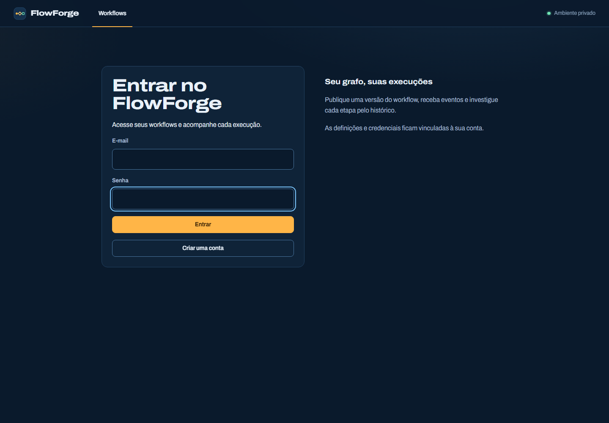
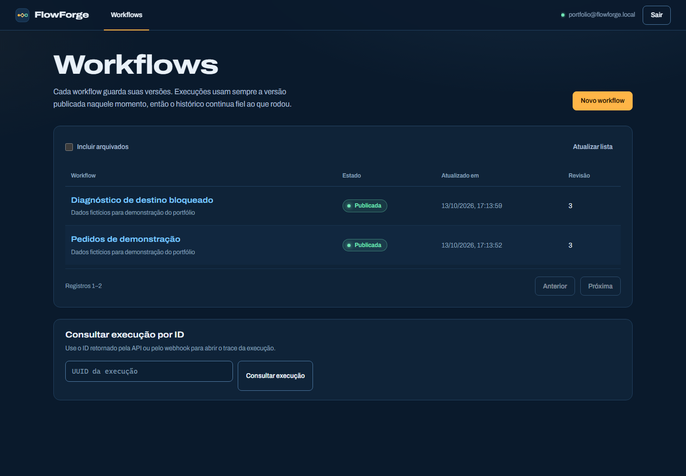
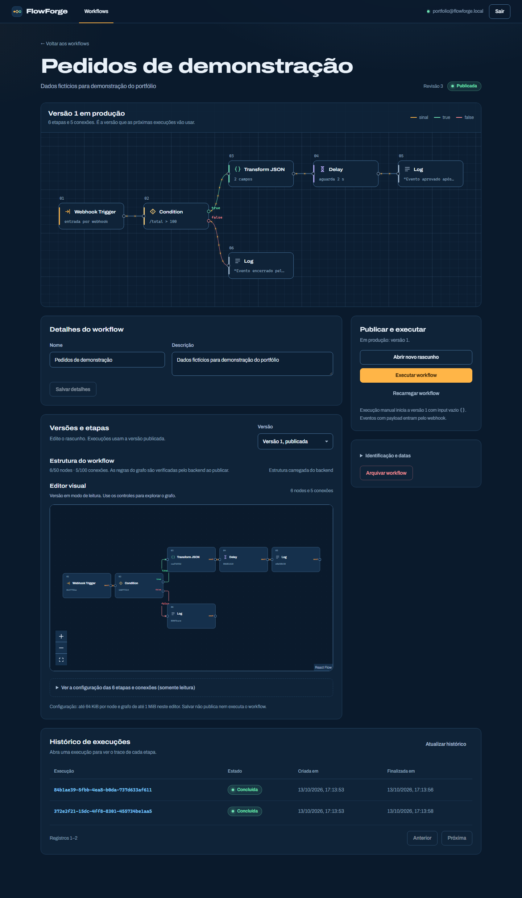
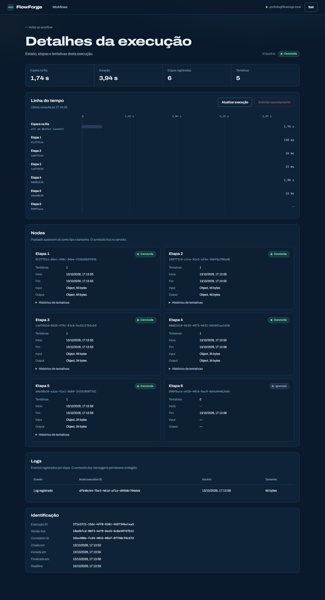
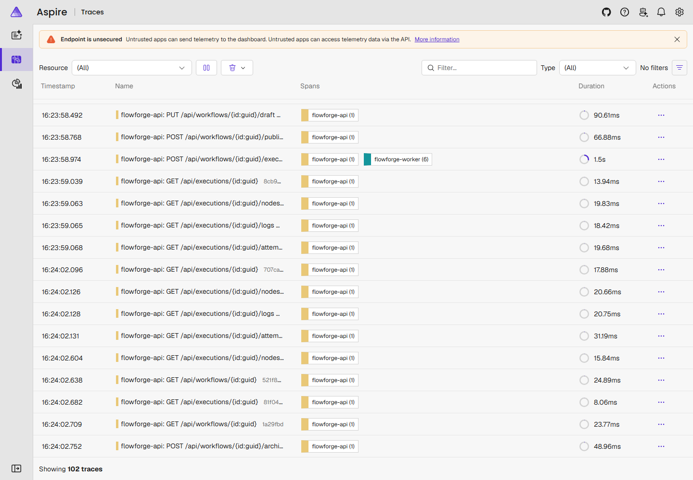

# FlowForge

Plataforma de automação por workflows construída com C#/.NET. Um usuário publica um grafo e acompanha execuções independentes, iniciadas por webhook ou pela interface. A API aceita o evento; um Worker executa etapas com checkpoints, histórico e recuperação após falhas.

O problema central é conciliar processamento assíncrono, efeitos externos e consistência: uma mensagem pode chegar novamente, o processo pode cair e um timeout pode acontecer depois que o destino executou a ação. O projeto torna essas situações explícitas e testáveis.

**Versão demonstrável de portfólio: backend, editor visual, autenticação e observabilidade.** Ambiente local/privado; implantação pública exige proteção externa do keyring e configuração operacional própria. Consulte [segurança](SECURITY.md) e [limites](docs/operations.md).

## O que funciona

- Workflows por proprietário, rascunho com controle de revisão e versões publicadas imutáveis.
- Editor React Flow com configurações tipadas, posições persistidas e portas true/false.
- Seis nodes: Webhook Trigger, HTTP Request, Condition, Transform JSON, Delay e Log.
- Histórico de execução/node/tentativa, inputs/outputs protegidos, logs e cancelamento cooperativo.
- Outbox/inbox, deduplicação, retry elegível com backoff/jitter, deadline, fencing, DLQ, redrive e replay explícitos.
- HTTP com allowlist HTTPS, conexão ao IP aprovado, TLS, sem redirects/proxy/cookies e limites de resposta.
- Contas Owner/Admin, JWT de cinco minutos, refresh rotativo em cookie, CSRF, revogação imediata e autorização por objeto.
- Traces API → RabbitMQ → Worker → node/HTTP, logs correlacionados e métricas de execução/espera/backlog.

Cada versão contém um DAG com um trigger. A execução percorre um caminho sequencial; ciclos, fan-out paralelo e joins de sincronização ficam fora do escopo.

## Arquitetura

Monólito modular com dois processos implantáveis. PostgreSQL guarda estado e autoridade de gravação; RabbitMQ desacopla o aceite do processamento.

~~~mermaid
flowchart LR
    UI[React / React Flow] --> API[ASP.NET Core API]
    Hook[Webhook + secret em header] --> API
    API -->|Transação: execução + outbox| DB[(PostgreSQL)]
    DB --> Dispatcher[Dispatcher no Worker]
    Dispatcher -->|Publisher confirm| MQ[RabbitMQ]
    MQ --> Consumer[Consumer / Engine]
    Consumer -->|Inbox + lease + checkpoints| DB
    Consumer --> HTTP[Origem HTTPS autorizada]
    API -. OTLP opcional .-> OTEL[Painel local de observabilidade]
    Consumer -. OTLP opcional .-> OTEL
~~~

| Projeto | Responsabilidade |
| --- | --- |
| Domain | Grafo, publicação, estados, limites e políticas; sem ASP.NET/EF |
| Application | Casos de uso, contratos e engine sequencial |
| Infrastructure | EF/PostgreSQL, RabbitMQ, HTTP aprovado, criptografia e exportação OTLP |
| API | Contratos HTTP, autenticação/autorização, limites e aceite de eventos |
| Worker | Despacho, consumo, retomada e recuperação |
| frontend | Editor, publicação e investigação de execuções |

[Arquitetura](docs/architecture.md), [modelo de dados](docs/data-model.md) e [ADRs](docs/decisions) explicam as escolhas. Código gerado de migrations representa o schema; regras de negócio permanecem explícitas no domínio e na engine.

## Stack e motivo

| Tecnologia | Problema resolvido |
| --- | --- |
| .NET 10 / ASP.NET Core / EF Core | API tipada, DI/lifetime e persistência com migrations revisáveis |
| PostgreSQL 17 | Transações, relações, revisões, leases/fencing e estado durável |
| RabbitMQ 4.2 | Entrega assíncrona, confirms, ACK e isolamento da request |
| React / TypeScript / Vite / Tailwind / React Flow | Interface tipada e edição de grafo com biblioteca especializada |
| Data Protection + Identity hashing | Proteção de contexto/credentials e hash de password |
| OpenTelemetry + Aspire standalone | Investigar processos separados e distinguir trabalho, espera e fila |
| xUnit / Testcontainers / Playwright | Comportamento, falhas e jornadas com serviços reais |
| Docker Compose / GitHub Actions | Ambiente reproduzível e gates de integração |

Redis é um profile opcional de laboratório, sem consumidor no produto. Locks e idempotência usam PostgreSQL. Acrescentá-lo ao caminho crítico agora duplicaria a autoridade do estado.

## Executar localmente

Requisitos: Docker com containers Linux/Compose v2, SDK .NET 10 e PowerShell 7. Node 22 é necessário para desenvolver/testar o frontend fora da imagem. Não há passwords padrão.

~~~powershell
git clone https://github.com/gabxw/flowforge.git
Set-Location flowforge
$env:FLOWFORGE_POSTGRES_PASSWORD = [System.Net.NetworkCredential]::new(
  '', (Read-Host 'Senha local do PostgreSQL' -AsSecureString)
).Password
$env:FLOWFORGE_RABBITMQ_PASSWORD = [System.Net.NetworkCredential]::new(
  '', (Read-Host 'Senha local do RabbitMQ' -AsSecureString)
).Password
docker compose up --build --detach --wait
./scripts/migrate-compose.ps1
./scripts/smoke-compose.ps1
~~~

Abra **http://localhost:5173** e crie a primeira conta local. O setup inicial cria Admin; contas seguintes são Owner. Faça isso antes de compartilhar acesso. A interface usa a API pelo proxy, sem tokens no storage do navegador.

Migrations são explícitas: o startup não altera schema. GenerateOnly no script permite revisar o SQL antes de aplicar. Os três volumes preservam PostgreSQL, RabbitMQ e keyring. Mantenha os mesmos secrets ao recriar serviços; não execute down --volumes em um ambiente que precisa preservar dados.

API: http://localhost:5080. OpenAPI local: /openapi/v1.json. Banco, broker e OTLP não publicam portas. Portas de API/frontend/painel ficam em loopback. [API](docs/api.md), [autenticação](docs/authentication.md) e [operação](docs/operations.md) detalham configuração e recuperação.

## Exemplo reproduzível

~~~mermaid
flowchart LR
    A[Webhook] --> B{total > 100?}
    B -->|true| C[Transform JSON]
    C --> D[Delay 2 segundos]
    D --> E[Log: aprovado]
    B -->|false| F[Log: alternativo]
~~~

Na mesma sessão PowerShell, use a conta criada na interface:

~~~powershell
$env:FLOWFORGE_SMOKE_EMAIL = Read-Host 'E-mail da conta local'
$env:FLOWFORGE_SMOKE_PASSWORD = [System.Net.NetworkCredential]::new(
  '', (Read-Host 'Password da conta local' -AsSecureString)
).Password
./scripts/demo-workflow.ps1 -IncludeFailure
~~~

O roteiro deixa workflows/histórico na interface: executa os dois ramos, repete um evento com a mesma chave e confirma a mesma execução. Também cria uma falha esperada de HTTP fora da allowlist, sem depender de um serviço externo. Imprime apenas IDs/resultados, nunca o secret do webhook ou o JWT. Cada chamada do roteiro cria uma nova demonstração.

[Roteiro de demonstração](docs/demo.md) mostra como investigar a falha e apresentar as decisões. [HTTP/credentials](docs/http-and-credentials.md) explica como autorizar uma origem real com segurança.

## Observabilidade

Antes de subir/recriar o ambiente, na sessão que contém os secrets:

~~~powershell
$env:FLOWFORGE_OTLP_ENDPOINT = 'http://dashboard:18889'
docker compose --profile observability up --build --detach --wait
~~~

Painel: **http://localhost:18888**. É anônimo e restrito à máquina local, com retenção em memória. Exportação começa desligada; não é necessária para executar automações. [Guia de investigação](docs/observability.md) descreve correlação, métricas e sanitização.

## Decisões que vale discutir

| Problema | Escolha e trade-off |
| --- | --- |
| Commit do banco seguido de publish pode falhar | Outbox transacional: aceite durável, com atraso e polling adicionais |
| Delivery pode se repetir ou Worker antigo continuar | Inbox + lease/fencing: protege gravações locais; não desfaz efeito remoto |
| Timeout não prova ausência de efeito externo | Retry só elegível, chave estável quando o destino coopera e resultado externo explícito |
| Espera longa prenderia delivery/thread | ResumeAt + continuação durável: mais estado/checkpoints, menos recursos retidos |
| CRUD aceitar mudanças em execução histórica | Versão publicada imutável: execução fixa configuração e contexto |
| Refresh roubado pode continuar renovando | Rotação/família/replay: reutilização revoga a família; exige serialização entre abas |
| Trace pode expor dados ou inflar métricas | Allowlist de atributos, sem baggage e dimensões limitadas; menos detalhes automáticos |

As garantias e limites estão em [confiabilidade](docs/execution-reliability.md), [segurança HTTP](docs/http-and-credentials.md), [sessões](docs/authentication.md) e [temas técnicos](docs/portfolio-topics.md). O projeto não promete exactly-once para sistemas externos.

## Qualidade

**1.282 testes xUnit**, **43 jornadas frontend** e **duas jornadas com Docker real**, além de lint/typecheck/build, migrations idempotentes e auditoria de dependências. A main exige três checks do GitHub Actions, inclusive para o administrador. Uma falha real de compilação foi verificada em [PR descartável bloqueado](https://github.com/gabxw/flowforge/pull/11).

~~~powershell
dotnet restore FlowForge.slnx --locked-mode
dotnet build FlowForge.slnx -c Release --no-restore
dotnet test FlowForge.slnx -c Release --no-build -m:1
npm --prefix frontend ci
npm --prefix frontend run lint
npm --prefix frontend run build
npm --prefix frontend test
~~~

[Catálogo e CI](docs/validation.md), [revisão da Fase 13](docs/phase-13-review.md), [Fase 14](docs/phase-14-review.md), [Fase 15](docs/phase-15-review.md) e [Fase 16](docs/phase-16-review.md) registram evidência e riscos. Pipeline não depende de serviços de produção. Não existe destino de deploy público configurado.

## Screenshots reais

## Evolução

As 16 fases e seus critérios estão no [roadmap](docs/roadmap.md). Próximos incrementos exigem necessidade concreta: proteção externa do keyring/collector para implantação, retenção executável, Schedule Trigger e novos conectores. Equipes, fan-out, plugins de código, cobrança e microsserviços permanecem fora do escopo entregue.
