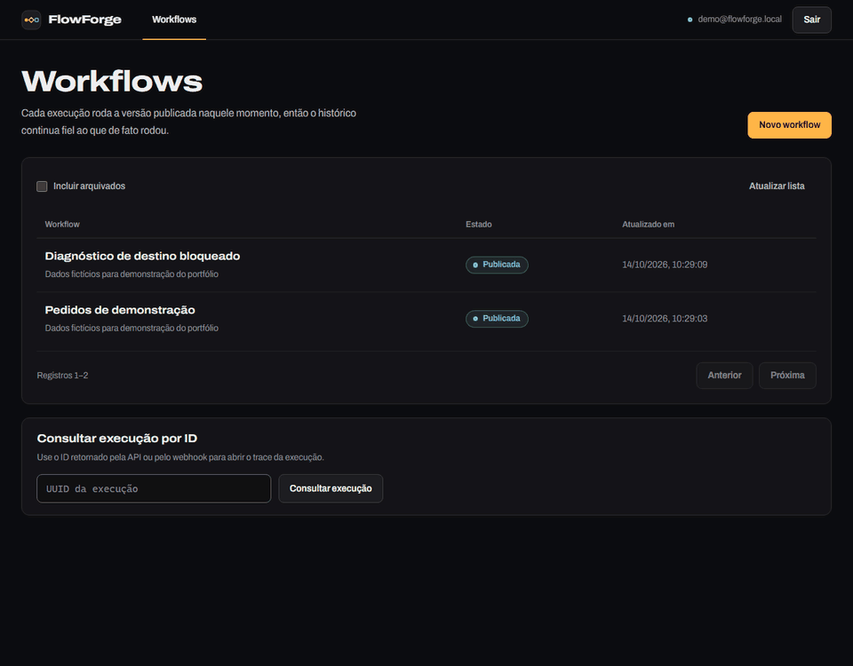
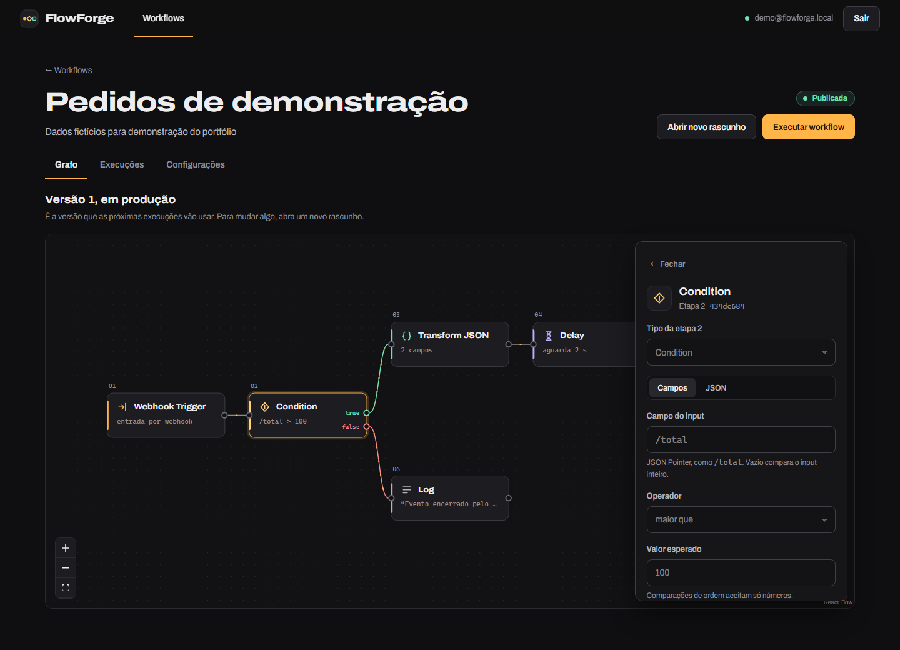
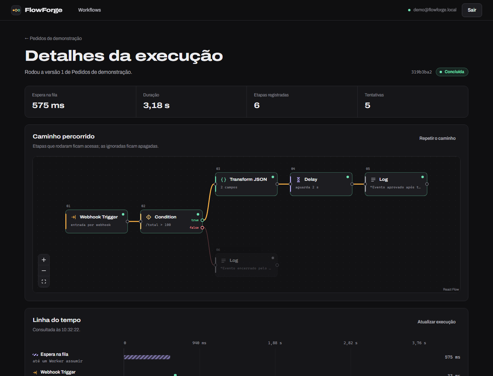
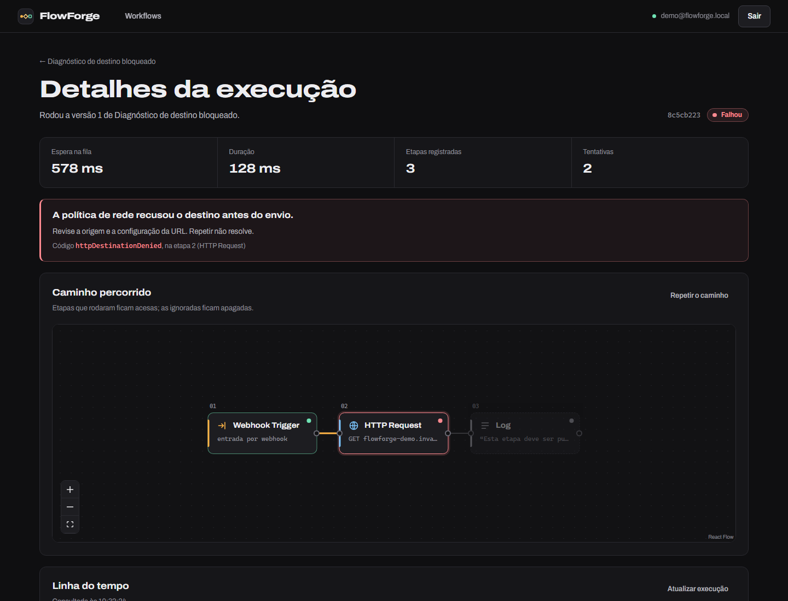

# FlowForge

Motor de automação por workflows em C#/.NET. Você desenha um grafo, publica uma versão e cada evento recebido por webhook vira uma execução independente, processada por um Worker com checkpoints, retry e recuperação após queda.

O problema central não é chamar uma API, é fazer isso de forma confiável quando as coisas falham no meio: o banco confirma e a fila cai, o Worker morre depois de um POST, o remetente reenvia o mesmo evento, um timeout chega depois que o destino já agiu. O projeto trata essas situações de forma explícita e cada uma tem teste com PostgreSQL e RabbitMQ reais.

## O que acontece quando

| Situação | Comportamento | Prova |
| --- | --- | --- |
| O RabbitMQ está fora do ar quando o webhook chega | A API grava execução e outbox na mesma transação e responde 202. O Worker publica quando o broker volta. | [WebhookEndpointTests](tests/FlowForge.Api.Tests/WebhookEndpointTests.cs) `Webhook_is_durable_without_broker…` |
| O remetente envia o mesmo evento duas vezes, ao mesmo tempo | Mesma `Idempotency-Key` e mesmo corpo devolvem a mesma execução; corpo diferente com a mesma chave é recusado com 409. | `Concurrent_duplicate_keys_return_one_execution…` |
| Um Worker trava, perde a lease e outro assume | O token de geração (fencing) impede o Worker antigo de gravar checkpoints depois de perder a posse. | [ExecutionEngineTests](tests/FlowForge.IntegrationTests/ExecutionEngineTests.cs) `Expired_generation_cannot_renew_begin_or_save…` |
| O Worker cai depois de enviar um POST e antes de gravar o resultado | O POST não é reenviado. A tentativa fica com resultado externo desconhecido, sem fingir que nada aconteceu. | [HttpExecutionTests](tests/FlowForge.IntegrationTests/HttpExecutionTests.cs) `Remote_effect_before_checkpoint_loss_is_not_sent_again…` |
| Um destino falha e o node tem retry | Só repete o que é seguro: métodos idempotentes ou destinos que aceitam `Idempotency-Key`, sempre com a mesma chave. | [RetryExecutionTests](tests/FlowForge.IntegrationTests/RetryExecutionTests.cs) `Unsafe_post_is_not_repeated…` |
| A mensagem vai para a DLQ antes de qualquer Worker pegá-la | O scanner devolve a mensagem à fila depois de 5 minutos, até 5 publicações. | [RecoveryAndDeadLetterTests](tests/FlowForge.IntegrationTests/RecoveryAndDeadLetterTests.cs) `Recovery_republishes_a_message_never_claimed…` |
| Um Delay de horas está em andamento | A espera é estado no banco. O Worker libera a mensagem e retoma no prazo, mesmo depois de reiniciar. | [DeclarativeExecutionTests](tests/FlowForge.IntegrationTests/DeclarativeExecutionTests.cs) `Waiting_delay_releases_lease…` |
| Uma URL resolve para a rede interna (SSRF, DNS rebinding) | A conexão é feita no IP validado; um segundo lookup não troca o destino. | [HttpRequestNodeTests](tests/FlowForge.IntegrationTests/HttpRequestNodeTests.cs) `Dns_rebinding_cannot_change…` |
| Uma conta tenta ler workflow, execução ou credencial de outra | 404, sem revelar que o recurso existe. Nem o Admin ignora o dono. | [AuthenticationEndpointTests](tests/FlowForge.Api.Tests/AuthenticationEndpointTests.cs) `Owner_isolated_by_object…` |
| Um refresh token roubado é reutilizado | A família inteira de sessões é revogada, inclusive os access tokens já emitidos. | `Refresh_rotation_replay_revokes_the_family…` |

O projeto não promete exactly-once em sistemas externos. Garante at-least-once com deduplicação local e deixa explícito quando o efeito remoto é desconhecido. Detalhes em [confiabilidade](docs/execution-reliability.md).

## Arquitetura

Monólito modular com dois processos: a API aceita comandos e eventos; o Worker publica a outbox, consome a fila e executa. O PostgreSQL é a autoridade do estado; o RabbitMQ só transporta.

~~~mermaid
flowchart LR
    UI[React / React Flow] --> API[ASP.NET Core API]
    Hook[Webhook + secret em header] --> API
    API -->|Transação: execução + outbox| DB[(PostgreSQL)]
    DB --> Dispatcher[Dispatcher no Worker]
    Dispatcher -->|Publisher confirm| MQ[RabbitMQ]
    MQ --> Consumer[Consumer / Engine]
    Consumer -->|Inbox + lease + checkpoints| DB
    Consumer --> HTTP[Origem HTTPS autorizada]
    API -. OTLP opcional .-> OTEL[Painel de observabilidade]
    Consumer -. OTLP opcional .-> OTEL
~~~

| Projeto | Responsabilidade |
| --- | --- |
| Domain | Grafo, publicação, estados e limites, sem ASP.NET nem EF |
| Application | Casos de uso, contratos e engine sequencial |
| Infrastructure | EF Core/PostgreSQL, RabbitMQ, HTTP com política de rede, criptografia e OTLP |
| API | HTTP, autenticação, autorização, rate limit e aceite de eventos |
| Worker | Despacho da outbox, consumo, retomada e recuperação |
| frontend | Editor do grafo, publicação e investigação de execuções |

Cada versão publicada é um DAG imutável com um trigger. A execução percorre um caminho sequencial; fan-out paralelo e joins ficam fora do escopo. [Arquitetura](docs/architecture.md), [modelo de dados](docs/data-model.md), [contrato do domínio](docs/domain-contract.md) e as [ADRs](docs/decisions) explicam as escolhas.

## Decisões e trade-offs

| Problema | Escolha | Custo |
| --- | --- | --- |
| Commit no banco seguido de publish pode perder a mensagem | Outbox transacional | Polling e atraso de despacho |
| Entrega repetida ou Worker antigo ainda vivo | Inbox, lease e fencing por geração | Heartbeats e consultas a mais; não desfaz efeito remoto |
| Timeout não prova que o destino não agiu | Retry só elegível e chave estável quando o destino coopera | Depende do contrato do destino |
| Espera longa prenderia mensagem e thread | `ResumeAt` e continuação durável | Mais estado e checkpoints |
| Edição mudaria execuções já na fila | Versão publicada imutável, fixada na execução | Novo rascunho para cada mudança |
| Refresh token roubado continuaria renovando | Rotação com família de sessão e detecção de reuso | Abas precisam serializar o refresh |
| Trace pode vazar dados | Allowlist de atributos e dimensões de métrica limitadas | Menos detalhe automático |

## Executar localmente

Requisitos: Docker com Compose v2, SDK .NET 10 e PowerShell 7. Node 22 para desenvolver o frontend fora da imagem. Não há senhas padrão.

~~~powershell
git clone https://github.com/gabxw/flowforge.git
Set-Location flowforge
$env:FLOWFORGE_POSTGRES_PASSWORD = [System.Net.NetworkCredential]::new(
  '', (Read-Host 'Senha local do PostgreSQL' -AsSecureString)
).Password
$env:FLOWFORGE_RABBITMQ_PASSWORD = [System.Net.NetworkCredential]::new(
  '', (Read-Host 'Senha local do RabbitMQ' -AsSecureString)
).Password
docker compose up --build --detach --wait
./scripts/migrate-compose.ps1
./scripts/smoke-compose.ps1
~~~

Abra **http://localhost:5173** e crie a primeira conta, que vira Admin do ambiente local. Migrations são explícitas: o startup não altera o schema. Os volumes preservam PostgreSQL, RabbitMQ e o keyring; mantenha os mesmos secrets ao recriar serviços. [API](docs/api.md), [autenticação](docs/authentication.md) e [operação](docs/operations.md) detalham configuração e recuperação.

### Exemplo reproduzível

~~~mermaid
flowchart LR
    A[Webhook] --> B{total > 100?}
    B -->|true| C[Transform JSON]
    C --> D[Delay 2 segundos]
    D --> E[Log: aprovado]
    B -->|false| F[Log: alternativo]
~~~

Com a conta criada na interface:

~~~powershell
$env:FLOWFORGE_SMOKE_EMAIL = Read-Host 'E-mail da conta local'
$env:FLOWFORGE_SMOKE_PASSWORD = [System.Net.NetworkCredential]::new(
  '', (Read-Host 'Senha da conta local' -AsSecureString)
).Password
./scripts/demo-workflow.ps1 -IncludeFailure
~~~

O roteiro cria esse workflow e um segundo com HTTP para um destino fora da allowlist. Envia eventos pelos dois ramos, repete um evento com a mesma chave para confirmar a deduplicação e deixa uma falha esperada para investigar na interface. Imprime só IDs e resultados, nunca o secret do webhook ou o token. O [roteiro de demonstração](docs/demo.md) mostra como investigar a falha.

### Observabilidade

~~~powershell
$env:FLOWFORGE_OTLP_ENDPOINT = 'http://dashboard:18889'
docker compose --profile observability up --build --detach --wait
~~~

Painel em **http://localhost:18888**, local e com retenção em memória. Um trace atravessa API, outbox, RabbitMQ, Worker e cada node; as métricas separam tempo ativo, espera e atraso de despacho. [Guia de investigação](docs/observability.md).

## Testes

| Conjunto | Quantidade | O que cobre |
| --- | --- | --- |
| Domínio | 794 | Grafo, publicação e a matriz completa de transições de estado (boa parte dos casos) |
| Aplicação | 111 | Engine sequencial, política de retry e casos de uso |
| Integração | 232 | PostgreSQL, RabbitMQ e servidor HTTPS reais em Testcontainers: falhas, recuperação, fencing, SSRF |
| API | 148 | Endpoints com banco real: contratos, autenticação, isolamento entre contas, rate limit |
| Navegador | 44 + 2 | Playwright com API simulada, e duas jornadas contra o ambiente Docker completo |

~~~powershell
dotnet restore FlowForge.slnx --locked-mode
dotnet build FlowForge.slnx -c Release --no-restore
dotnet test FlowForge.slnx -c Release --no-build -m:1
npm --prefix frontend ci
npm --prefix frontend run lint
npm --prefix frontend test
~~~

A main exige os três jobs do GitHub Actions (backend, frontend e ambiente Docker), inclusive para o administrador. [Catálogo de validação](docs/validation.md).

## Telas

| | |
| --- | --- |
|  |  |
|  |  |

## Limites

Ambiente local e privado. Uma implantação pública exige proteção externa do keyring, collector autenticado para telemetria e política de retenção; não há destino de deploy configurado. Consulte [segurança](SECURITY.md) e [operação](docs/operations.md). As 16 fases de construção e seus critérios estão no [roadmap](docs/roadmap.md).
